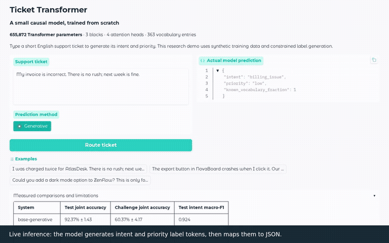
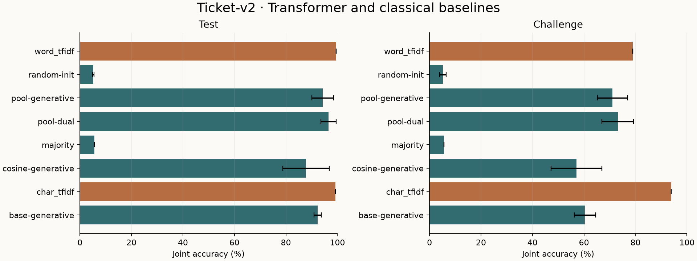

<div align="center">

# Transformers from Scratch & Fine-Tuning

**Build a Transformer. Measure what it learns. Compare it with simpler models.**

An ML engineering portfolio focused on **transparent PyTorch implementations**, **reproducible experiments**, **honest baselines**, and **working inference demos**.

[Quick start](#quick-start) · [Results](#measured-results) · [Architecture](#model-and-experiment-design) · [Reproducibility](#reproduce-the-results) · [Limitations](#limitations-and-research-integrity)

</div>

> [!IMPORTANT]
> **Project status:** The **pretraining/training-from-scratch track is implemented and evaluated**. The **SmolLM2 LoRA fine-tuning track is planned**, not yet integrated in the version described here. This repository currently demonstrates a **656K-parameter task-specific causal Transformer trained from random initialization**.

## At a glance

| Track | Status | What it demonstrates |
| --- | --- | --- |
| [Training from scratch](pretraining/README.md) | **Implemented · evaluated · demo available** | A 656K-parameter causal Transformer, tokenizer trained only on training data, nine training runs, classical baselines, checkpoint recovery, and error analysis |
| [Fine-tuning](finetuning/README.md) | **Planned** | LoRA adaptation of a pretrained SmolLM2 checkpoint for structured job-information extraction |

**Repository design:** two independent Python packages under a single `uv` workspace, shared dependency lockfile, and track-specific documentation. Code, model artifacts, and experimental claims are kept separate.

## Demo: structured ticket decisions

**Input:** a support ticket written in natural language.  
**Output:** a generated structured prediction for **intent** and **priority**.



<details>
<summary><strong>What does the demonstration prove?</strong></summary>

The model generates the expected task-specific fields after training from random weights. The demo is **not** evidence of robust performance on real customer-support tickets, and the model is not a general-purpose chat assistant. For model behavior, reproducible predictions, and known failure patterns, see the [pretraining case study](pretraining/README.md).

</details>

## Measured results

The project uses a **versioned, synthetic ticket-v2 benchmark**. For the pooled-head training variant with dual-head decoding, three independent seeds produced:

| Evaluation | Transformer: mean ± reported variation | Strong classical baseline |
| --- | ---: | ---: |
| **Test · joint intent + priority accuracy** | **96.51% ± 2.98** | Word TF-IDF: **99.51%** |
| **Challenge · joint accuracy** | **73.15% ± 6.14** | Character TF-IDF: **93.89%** |

> **Bottom line:** The Transformer learns task-relevant representations, but **does not outperform the strongest classical baselines** on this synthetic task. The performance gap is particularly large on challenge examples. The ± values are reproduced as reported by the project and should not be interpreted as confidence intervals without reviewing their calculation in the full case study.



### What was compared?

- Multiple Transformer training variants, including pooled-head auxiliary supervision and dual-head inference.
- **Word TF-IDF** and **character TF-IDF** classical approaches.
- Multiple random seeds, validation-based checkpoint selection, and an explicit challenge split.
- Qualitative error analysis, training curves, and checkpoint recovery.

**Read the complete evidence:** [Pretraining experiments and case study](pretraining/README.md) — per-seed scores, run selection, charts, uncertainty, reproducibility instructions, and failure cases.

## Model and experiment design

### Training from scratch: task-specific causal Transformer

```text
Synthetic ticket-v2 data
        │
        ▼
Training-only tokenizer
        │
        ▼
Causal Transformer (~656K parameters)
        │
        ├── Autoregressive token predictions
        │
        └── Optional pooled auxiliary heads (training variants)
        │
        ▼
Validation-selected checkpoint
        │
        ▼
Intent + priority predictions
        │
        ▼
Held-out test / challenge evaluation
```

- **Initialization:** Random model weights, not a downloaded pretrained checkpoint.
- **Objective:** Task-specific structured decisions expressed through causal language-model output; variants investigate auxiliary supervision.
- **Data integrity:** The tokenizer is trained on the training partition to avoid vocabulary leakage.
- **Evaluation discipline:** Different random seeds, validation selection, and explicit reporting of held-out and challenge behavior.
- **Interpretation:** Demonstrates Transformer fundamentals and experiment design, not large-scale language pretraining.

### Planned fine-tuning: SmolLM2 + LoRA

The planned fine-tuning track will adapt an **already pretrained SmolLM2** model for **structured job-information extraction** with low-rank adapters. The intended comparisons are an unchanged base model, prompted base model, and fine-tuned adapter, evaluated for structured-output validity, extraction accuracy, inference efficiency, and failure modes.

**No fine-tuned weights, improvements, or benchmark numbers are claimed here.** Refer to the [fine-tuning track README](finetuning/README.md) for its implementation status and eventual results.

## Quick start

**Supported documented environment:** Linux x86-64 (including WSL2), Python **3.12.12**, and `uv` **0.12.1**.

From the repository root:

```bash
uv python install 3.12.12
uv sync --locked --extra cpu --group pretraining --group demo

# Prepare the versioned local synthetic data
uv run --no-sync pretraining data prepare \
  --config pretraining/configs/ticket-base.toml

# Train a new random-initialized model
uv run --no-sync pretraining train \
  --config pretraining/configs/ticket-base.toml \
  --run-id ticket-v2-base-42

# Launch the interactive demo for this run
uv run --no-sync pretraining demo \
  --model pretraining/runs/ticket-v2-base-42 \
  --report pretraining/reports/ticket-v2
```

Open **http://127.0.0.1:7860** for the Gradio demo.

> [!NOTE]
> The commands above train the **validation-selected base configuration**, which is intentionally distinct from the **best average test-scoring pooled/dual-head variant** reported in the results table. To reproduce that specific reported result, use the full experiment matrix in the track-specific guide rather than assuming the single base command produces 96.51%.

**Compute:** The documented CPU training time was approximately **one minute per run** on an Intel i5-13420H with two PyTorch threads. This is a recorded environment-specific observation, not a runtime guarantee. The shown training workflow does not require downloading pretrained weights or datasets.

## Reproduce the results

To reproduce the **three-seed benchmark**, follow the [pretraining reproduction guide](pretraining/README.md#reproduce-the-experiments). It covers the exact run configurations, experiment matrix, evaluation commands, artifact checks, notebook workflow, and demo recording.

| Goal | Where to look |
| --- | --- |
| Reproduce training and checkpoint selection | [Pretraining guide](pretraining/README.md) |
| Inspect model comparisons and failures | [Pretraining case study](pretraining/README.md) |
| View the recorded demo | [Demo preview](pretraining/docs/assets/demo-preview.gif) |
| Review planned LoRA work | [Fine-tuning guide](finetuning/README.md) |
| Follow implementation milestones | [P01 roadmap](plan.md) |

**Artifact policy:** Full datasets, trained checkpoints, environments, and videos are intentionally kept outside Git. The repository includes compact evaluation reports and preview media. Follow the reproduction guide to regenerate local artifacts; do not expect a pretrained model checkpoint to be committed in the repository.

## Environment profiles and quality checks

The two track packages share the root `uv.lock` and `.venv`. Select **one compute profile** for an environment:

| Profile | Purpose | Verification status |
| --- | --- | --- |
| `cpu` | Documented local and CI path | Used for the reported CPU workflow |
| `cu126` | Local CUDA training | Lock-resolved, not GPU-validated |
| `cu128` | Planned Hugging Face Space GPU environment | Lock-resolved, not GPU-validated |

The CUDA profiles' **3 GiB VRAM target has not been verified**. When running commands from a track directory, use `--project ..` for the root project as described in the track documentation. Keep `--no-sync` on later run commands to preserve your selected environment profile.

Run the software checks from the repository root:

```bash
uv run --no-sync ruff check .
uv run --no-sync ruff format --check .
uv run --no-sync mypy
uv run --no-sync pytest
uv lock --check
uv build --all-packages
uv run --no-sync python scripts/verify_profiles.py
```

[CPU GitHub Actions](.github/workflows/cpu.yml) checks formatting, typing, tests, and lightweight fixtures. It **does not rerun the full training and evaluation matrix**.

## Repository navigation

```text
.
├── README.md                      # Project overview (this file)
├── pretraining/                   # Implemented from-scratch ticket model
│   ├── README.md                  # Experiments and full reproduction guide
│   ├── configs/                   # Versioned run configurations
│   ├── docs/assets/               # Demo preview
│   └── reports/ticket-v2/         # Compact evaluation reports and plots
├── finetuning/                    # Planned SmolLM2 LoRA track
│   └── README.md
├── .github/workflows/cpu.yml      # Lightweight CI
├── scripts/verify_profiles.py     # Environment-profile checks
├── pyproject.toml                 # uv workspace configuration
├── uv.lock                        # Locked dependencies
└── plan.md                        # P01 milestones and issue contracts
```

This is an **overview of the important paths**, not a claim that the repository contains only these files.

## Limitations and research integrity

1. **Synthetic data only:** Ticket-v2 results do not establish real-world customer-support accuracy.
2. **Strong classical baselines:** Word TF-IDF wins on the reported test benchmark; character TF-IDF is stronger on the challenge split.
3. **Small scope:** A 656K-parameter, task-trained causal model should not be confused with a broadly pretrained large language model.
4. **Fine-tuning scope:** SmolLM2 LoRA fine-tuning remains planned in the described repository state; no completed fine-tuning result is claimed.
5. **Environment boundaries:** CUDA execution, 3 GiB VRAM compatibility, public Space deployment, and full-matrix CI are not verified.
6. **Reproducibility:** Results depend on specified seeds, configurations, versions, and validation-based checkpoint selection. Refer to the detailed experiment records before quoting individual model variants.


