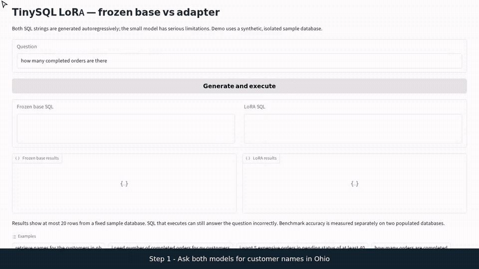
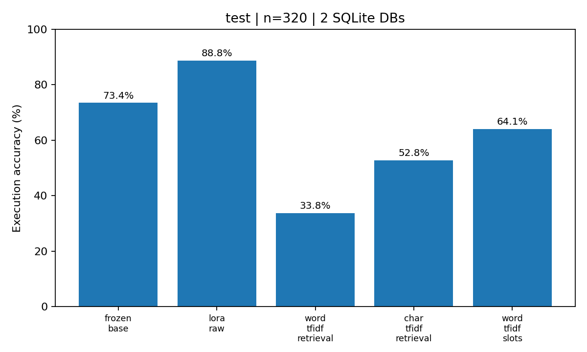
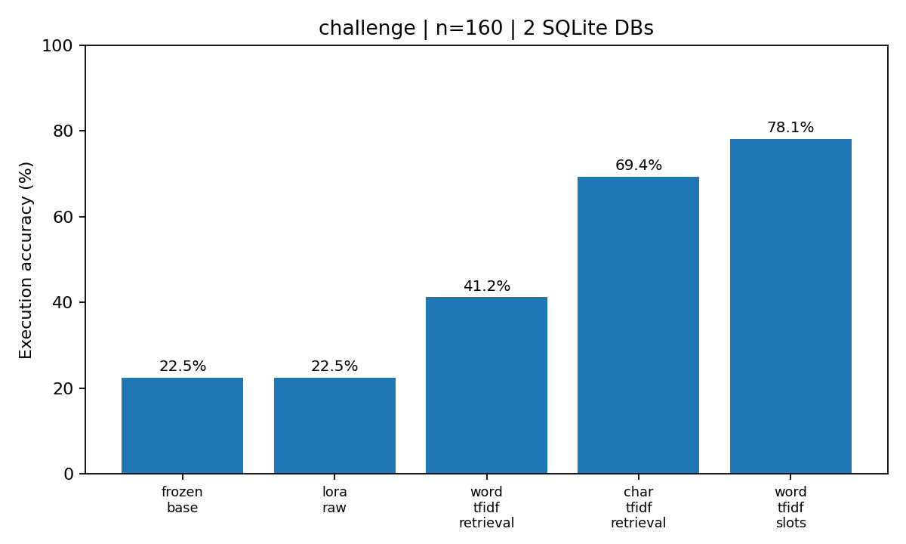

# TinySQL: custom LoRA over a separately trained base

This implemented experiment adapts a **439,552-parameter SQL Transformer** using **32,768
trainable low-rank parameters**. The base was independently trained from random weights
on synthetic question/SQL pairs. It is separate from the ticket model in `../pretraining/`.
The two tracks share tooling, not weights or tasks.



The [demo walkthrough](#demo-and-recorded-walkthrough) shows real generated queries,
execution results and a failure from the historical base and rank-8 adapter.

## Historical measured results

Unrestricted greedy generation is compared by executing SQL on two populated SQLite
databases. These validation/test/challenge splits contain 320/320/160 rows.

| System | Validation | Historical test | Challenge |
| --- | ---: | ---: | ---: |
| Frozen base | 69.38% | 73.44% | 22.50% |
| Released rank-8 LoRA | 75.94% | 88.75% | 22.50% |
| Word TF-IDF retrieval | 50.31% | 33.75% | 41.25% |
| Character TF-IDF retrieval | 65.31% | 52.81% | 69.38% |
| TF-IDF + slot copying | 78.44% | 64.06% | 78.12% |




The historical test gain is +15.31 percentage points, with a row-paired bootstrap interval
of +11.56 to +19.38 points. This describes the observed rows, not training-seed or real-world
uncertainty. **Challenge execution accuracy does not improve**, and SQL validity falls
from **41.25% to 25.00%**. These splits were inspected in earlier development; the results
are exploratory. [Detailed report](docs/EXPERIMENT_REPORT.md) and
[per-example predictions](reports/test_final_predictions.jsonl) include actual failures.

The historical release is identified as `adapters/aug_r8_fast`; its files are managed
outside Git. This name does not claim the best configuration. Rank 4 has
lower recorded validation CE (0.04385 versus 0.04405); some configurations were evaluated
on a 96-row validation subset. The complete cross-run release rationale was not recorded.
Within each training run, checkpoint selection uses validation SQL-token cross-entropy.

## Model, data and provenance

- Base: two decoder blocks, width 128, four heads, context 160, tied embeddings, 174-token vocabulary.
- LoRA: rank 8, alpha 16, zero dropout; QKV, attention projection and both feed-forward projections.
- Adapter/base fraction: **7.45%**. Adapter/combined-model fraction: **6.94%**.
- Original training: **6,400 rows / 1,968 unique questions**. Augmented adapter training:
  **15,930 rows / 3,525 unique questions**. Repetition is part of the historical training distribution.
- Tokenizer fitted only on original training data. No exact training question overlaps with
  validation/test/challenge, but SQL skeletons and many output programs recur across splits.
- Prompt tokens are masked; loss supervises SQL continuation and EOS. Every original base
  parameter remains frozen during adapter optimization.

[Dataset card](docs/dataset-card.md) and the compact
[data manifest](experiments/data-manifest.json) document regeneration and expected checksums.
The historical base's exact training configuration/source identity is incomplete; new
training is not a guarantee of reconstructing that checkpoint bit-for-bit. New runs record
configuration, environment and source/data identities. The compact
[reference-artifact manifest](experiments/reference-artifacts.json) identifies the original
base and rank-8 adapter without checking their weight files into Git.

## Source-only setup

From repository root:

```bash
uv python install 3.12.12
uv sync --locked --extra cpu --group pretraining --group demo
cd finetuning
```

Weights, adapter runs, tokenizers and generated datasets are local artifacts. The repository
contains their generators and reference measurements. No historical-weight download URL
is configured, and no pretrained model is downloaded automatically.

## Generate data and train new models

From `finetuning/`, use fresh output directories:

```bash
uv run --project .. --no-sync python -m finetuning.tinysql.data --out data
uv run --project .. --no-sync python -m finetuning.lora_sql.augment \
  --src data/train.jsonl --out runs/augmentation/train.jsonl
uv run --project .. --no-sync python -m finetuning.tinysql.train \
  --data-dir data --out runs/base --epochs 20 --seed 42 --device cpu --num-threads 2
uv run --project .. --no-sync python -m finetuning.lora_sql.train_lora \
  --base runs/base --data runs/augmentation --out runs/adapter \
  --rank 8 --alpha 16 --lr 0.0003 --batch 64 --epochs 1 --steps 90 --seed 42 --device cpu
```

The first training command initializes a new SQL base; the second freezes it and trains
only LoRA parameters. These are new experiments, so their scores may differ from the
historical table. To check the pipeline quickly, add `--epochs 1 --steps 12` to base training
instead of `--epochs 20`, and use `--steps 12` for the adapter. Such smoke runs are diagnostics.

Training refuses existing output directories. Adapter checkpoint selection uses validation
SQL-token CE within the run. Failed adaptation retains its initial zero-update adapter.
The augmentation directory includes an unchanged validation copy; all augmentation wording
comes from the original training split. Keep test/challenge outcomes out of configuration selection.

## Evaluate and launch the demo

```bash
uv run --project .. --no-sync python -m finetuning.lora_sql.evaluate_lora \
  --base runs/base --data data --adapter runs/adapter/adapter.pt \
  --split val --count 32 --output runs/evaluation/val.json
uv run --project .. --no-sync python spaces/app.py \
  --base runs/base --adapter runs/adapter/adapter.pt
uv run --project .. --no-sync python scripts/demo_compare.py \
  --base runs/base --adapter runs/adapter/adapter.pt
```

Open http://127.0.0.1:7860. The demo and evaluation share greedy decoding with an 85-token
budget bounded by the original context. Only an isolated synthetic database is supported.
Unknown wording and lightly trained models can produce invalid or incorrect SQL.

## Demo and recorded walkthrough

The preview above comes from an actual local browser recording with the historical
`base_small` and `aug_r8_fast` artifacts. It shows two selected corrections, followed by
unfamiliar wording that makes the adapter reference a nonexistent `price` column.
It illustrates behavior rather than estimating accuracy; the complete-split measurements
and their limitations are reported above.

To record your own matching base/adapter pair, launch the app using the command above.
In another terminal, from the repository root:

```bash
uv sync --locked --extra cpu --group pretraining --group demo --group media
uv run --no-sync playwright install --with-deps chromium
uv run --no-sync python finetuning/scripts/record_demo.py --rehearse
uv run --no-sync python finetuning/scripts/record_demo.py --output finetuning/runs/demo-new
```

The rehearsal checks all three questions before recording. The recorder writes a captioned
MP4, raw browser video and the actual generated SQL/results to the ignored output directory.
It updates the compact GIF in `docs/assets/`; use `--assets PATH` to keep
alternative previews elsewhere. Media tools are optional and are not required for training
or using the live app. Launch only one demo on port 7860 at a time.

## Full-split evaluation

`--count 0` evaluates the full split and is the default. A subset is not a full benchmark.
For a full analysis of a chosen checkpoint, evaluate `val`, `test` and `challenge` into new
output files. Generate figures with:

```bash
uv run --project .. --no-sync python -m finetuning.lora_sql.plots \
  --run-dir runs/adapter --report runs/evaluation/val.json --out runs/evaluation/plots
```

## Replay the historical checkpoint

Exact replay requires separately restoring `base_small/` (model, tokenizer and metadata)
and `adapters/aug_r8_fast/` (adapter, metadata and compatibility manifest). Check their
identities against [reference-artifacts.json](experiments/reference-artifacts.json).
Existing local copies remain untouched by the Git cleanup; fresh clones do not include them.
The adapter must be paired with its exact historical base, not a newly trained substitute.

Regenerate original data with `finetuning.tinysql.data --out data` and historical augmentation
with `finetuning.lora_sql.augment --out data_lora/train.jsonl`. After restoring the weights:

```bash
for split in val test challenge; do
  uv run --project .. --no-sync python -m finetuning.lora_sql.evaluate_lora \
    --base base_small --data data --adapter adapters/aug_r8_fast/adapter.pt \
    --split "$split" --count 0 --output "runs/historical-replay/$split.json"
done
```

Compare these results with the versioned `reports/*_final.json` files. The historical test
and challenge sets remain exploratory, even when their predictions reproduce exactly.

## Notebook, tests and local export

The [notebook](notebooks/Train_TinySQL_LoRA_From_Scratch.ipynb) generates its own data and
uses local base weights if available. In training mode it creates a base when none exists;
smoke mode performs only 12 base/adapter updates. `BASE_DIR` and `ACTIVE_ADAPTER` identify
the models used by every later cell. Inference-only mode requires externally restored
historical artifacts. Colab and GPU execution remain unverified.

From repository root: `uv run --no-sync pytest finetuning/tests`. Tests generate temporary
corpora and tiny model/adapter artifacts. Only the optional historical-checkpoint integration
test is skipped when those external weights are missing; normal CI needs no checked-in models.

Export the selected local model with its exact base, tokenizer, source and matching report:

```bash
uv run --project .. --no-sync python -m finetuning.lora_sql.publish \
  --adapter runs/adapter --base runs/base --out runs/exports/tinysql \
  --report runs/evaluation/val.json
uv run --project .. --no-sync python runs/exports/tinysql/predict.py "how many orders are completed"
```

Only reports identifying the exported adapter hash are included in its card. Export is
local and performs no Hub upload. The custom architecture is not an AutoModel/PEFT package.
See [export notes](hf_adapter/README.md) and [demo instructions](spaces/README.md).
