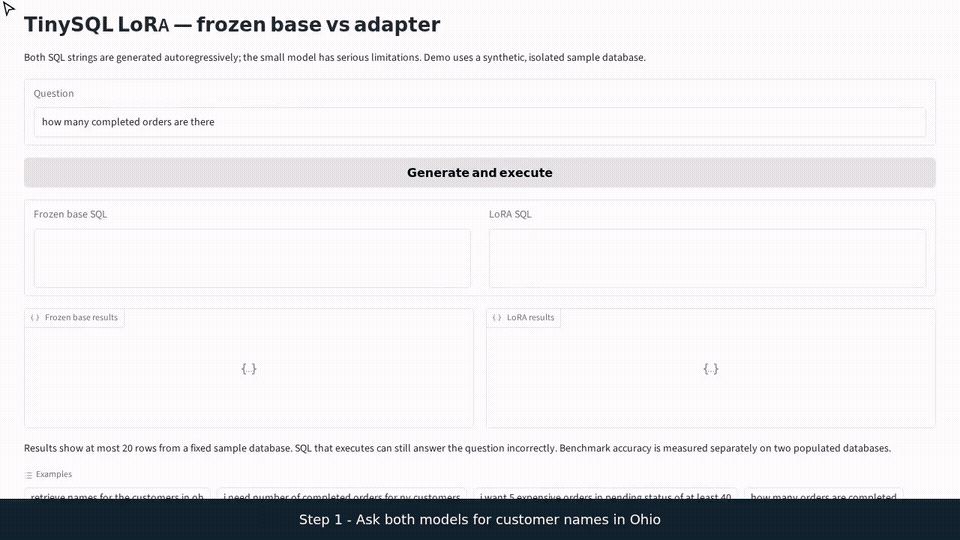

# Local TinySQL demo



Generate data and train a local base/adapter using the [experiment guide](../README.md).
Then, from repository root:

```bash
uv run --no-sync python finetuning/spaces/app.py \
  --base finetuning/runs/base --adapter finetuning/runs/adapter/adapter.pt
```

Open http://127.0.0.1:7860. The app imports the installed `finetuning` package and executes
only against freshly populated synthetic databases. A fresh clone includes no model weights.
Use `--base` and `--adapter` to select a matching pair of locally trained or restored artifacts.
Both models generate SQL for the same question. The app displays each query and its
execution result, including SQL errors. Successful execution alone does not establish
that the question was answered correctly.

See the [recording instructions](../README.md#demo-and-recorded-walkthrough) to reproduce
the preview with real browser interactions. The preview uses the historical checkpoint
pair; newly trained models may behave differently.

The folder name is historical; no public Space deployment is claimed. Follow the
[export instructions](../hf_adapter/README.md) for a portable local inference bundle.
