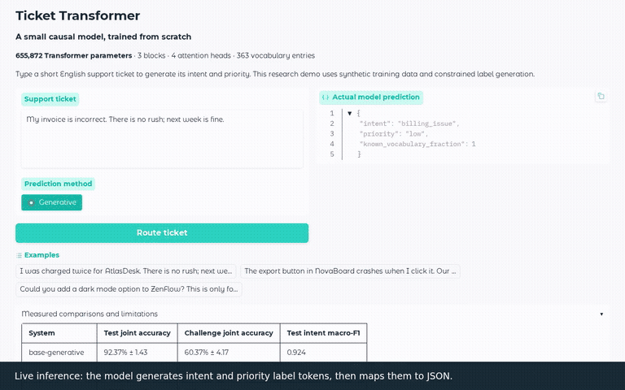
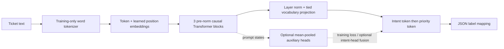
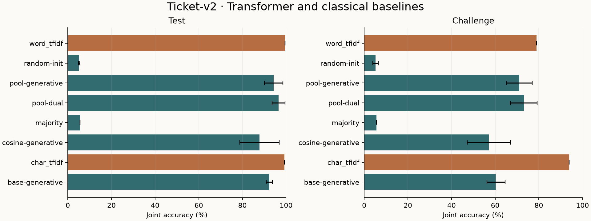
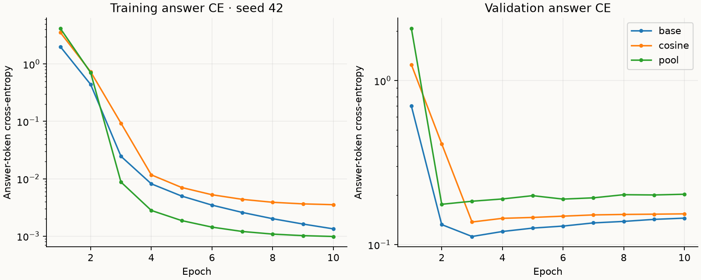
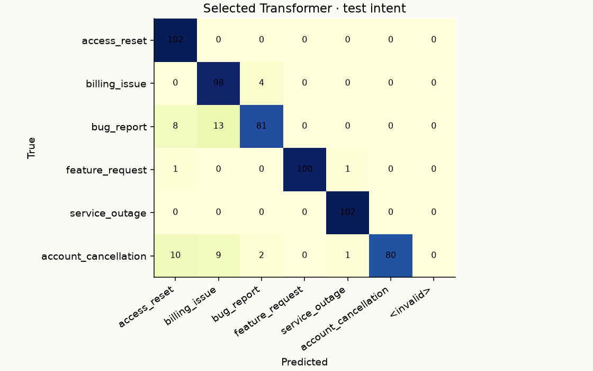

# Ticket Transformer trained from scratch

A **655,872-parameter decoder-only Transformer** learns to route short support tickets
into six intents and three priorities. Every weight starts from random initialization.
The project includes a deterministic synthetic dataset, training and recovery,
classical comparisons, three-seed ablations, an evaluated artifact and a local Gradio demo.



Example input: `My invoice is incorrect. There is no rush; next week is fine.`

```json
{"intent": "billing_issue", "priority": "low"}
```

The decoder generates two constrained label tokens and maps them to JSON. Training
supervises the label continuation and EOS, with prompt/padding loss masked. This is
a task-specific language model; this experiment does not perform general text pretraining.

## Architecture



| Setting | Value |
| --- | --- |
| Layers / heads / width | 3 / 4 / 128 |
| Context / vocabulary | 112 / 363 tokens on the full training split |
| MLP / activation / dropout | 512 / GELU / 0.1 |
| Embeddings | Learned positions; tied input/output token weights |
| Model parameters | 655,872 |
| Auxiliary parameters | 1,161; 657,033 total when enabled |
| Optimization | AdamW, LR 8e-4, decay 0.01, norm clipping 1.0 |
| Full training | 10 epochs, batch 64, 570 updates |
| Schedule ablation | Flat versus 10% warmup + cosine to a 5% floor |
| Auxiliary objective | Answer CE + 2 × (intent CE + priority CE) |

The model and inference code are under `src/pretraining/`. Inference imports neither
scikit-learn nor plotting nor training. A single trainer serves commands and notebook.

## Results: ticket-v2

The matrix was frozen before training: three configurations × seeds **42, 7, 123**.
Validation chooses each checkpoint and the demo configuration before final scoring.
All variants see the same examples and split definitions. Tokenizers and TF-IDF
vectorizers are fitted on training only.

<!-- RESULTS:START -->
| System | Test joint accuracy | Challenge joint accuracy | Test intent macro-F1 |
| --- | ---: | ---: | ---: |
| base-generative | 92.37% ± 1.43 | 60.37% ± 4.17 | 0.924 |
| char_tfidf | 99.18% | 93.89% | 0.992 |
| cosine-generative | 87.85% ± 9.05 | 57.04% ± 9.88 | 0.874 |
| majority | 5.56% | 5.56% | 0.048 |
| pool-dual | 96.51% ± 2.98 | 73.15% ± 6.14 | 0.966 |
| pool-generative | 94.34% ± 4.19 | 71.11% ± 5.85 | 0.943 |
| random-init | 5.23% ± 0.28 | 5.19% ± 1.28 | 0.076 |
| word_tfidf | 99.51% | 78.89% | 0.995 |

± denotes sample standard deviation across three fixed seeds. Classical baselines are single fitted systems.

<!-- RESULTS:END -->




The main demo uses **base / generative / seed 42**, selected by mean validation
joint accuracy, then intent macro-F1, then answer CE and deterministic ties. Its
individual test joint accuracy is **91.99%** and challenge joint accuracy **55.56%**.
Pooled-head variants score better on average test data, but the demo was not
reselected using those test outcomes.

Classical methods remain stronger here. The selected checkpoint versus the
validation-selected character baseline has a test joint-accuracy difference of
−7.19 percentage points (paired template-cluster bootstrap 95% interval:
−16.91 to −0.16). This interval concerns synthetic template sampling, not production
performance or training-seed uncertainty.

[Individual metrics and supports](reports/ticket-v2/benchmark.json),
[per-system summaries](reports/ticket-v2/summary.csv),
[selection evidence](reports/ticket-v2/selection.json), and
[paired uncertainty](reports/ticket-v2/benchmark.json) are committed with per-example
prediction IDs. **Joint accuracy requires both labels to match.** Macro-F1 includes
all fixed classes. Rejected inputs stay in denominators. Priority is almost perfect
because the generator uses explicit, shared urgency phrases.

## Reproduce the experiments

Run from the repository root. Paths inside TOML files resolve relative to that file,
so installed commands also work from another working directory with an absolute config path.

```bash
uv python install 3.12.12
uv sync --locked --extra cpu --group pretraining --group demo
uv run --no-sync pretraining data prepare --config pretraining/configs/ticket-pool.toml
```

**Tiny CPU smoke and software tests:**

```bash
uv run --no-sync pytest pretraining/tests
uv run --no-sync pretraining train --config pretraining/configs/smoke.toml --run-id smoke-local
```

The smoke is a shortened diagnostic, not a benchmark result. Use a new run ID for
each new run; existing IDs are protected from accidental overwrite.

**Train the selected model and evaluate the saved artifact:**

```bash
uv run --no-sync pretraining train --config pretraining/configs/ticket-base.toml --run-id ticket-v2-base-42
uv run --no-sync pretraining evaluate --config pretraining/configs/ticket-base.toml --model pretraining/runs/ticket-v2-base-42 --split test
uv run --no-sync pretraining evaluate --config pretraining/configs/ticket-base.toml --model pretraining/runs/ticket-v2-base-42 --split challenge
uv run --no-sync pretraining predict --model pretraining/runs/ticket-v2-base-42 --text "My invoice is incorrect. There is no rush; next week is fine."
```

**Repeat all nine runs and baseline comparisons:**

```bash
uv run --no-sync pretraining benchmark --config pretraining/configs/ticket-pool.toml --output pretraining/runs/reproduction-report
```

The benchmark reuses matching completed runs and resumes matching epoch recovery
checkpoints. A changed scientific source/config/data contract requires a new run
location. Its contract and selection record are written before final evaluation.
Use a fresh output path to preserve the committed reference reports.

Recovery is at completed epoch boundaries. An interrupted partial epoch is replayed
from the preceding boundary; optimizer, scheduler, Python/Torch RNG and loader RNG
states are restored. Resume with the original config and
`--resume pretraining/runs/RUN_ID/recovery.pt`. Complete runs cannot be extended
silently with changed settings.

The [walkthrough notebook](notebooks/Ticket_Transformer.ipynb) calls these same
package workflows. It requires the repository and locked environment; no ZIP upload,
notebook-only trainer, or pretrained model download is involved.

## Demo and recorded walkthrough

```bash
uv run --no-sync pretraining demo --model pretraining/runs/ticket-v2-base-42 --report pretraining/reports/ticket-v2
```

The app shows live predictions, vocabulary coverage, measured comparisons, learning
curves and reproduction commands. Vocabulary coverage is not calibrated confidence.
Pooled checkpoints also offer intent-head fusion (historical mode name `dual`); for example, use a trained
`ticket-v2-pool-42` artifact to compare both decoding modes.

The GIF above is taken from an actual browser recording. Each ticket is typed character
by character before requesting a real model prediction, matching the fine-tuning preview.
It shows a correct example, an urgency edit and a real failure. The full walkthrough also
shows results and reproduction. A captioned MP4, SRT, transcript and displayed predictions
are generated locally in ignored `pretraining/runs/demo/`.

To record again after training:

```bash
uv sync --locked --extra cpu --group pretraining --group demo --group media
uv run --no-sync playwright install --with-deps chromium
uv run --no-sync python pretraining/scripts/record_demo.py --model pretraining/runs/ticket-v2-base-42 --report pretraining/reports/ticket-v2 --output pretraining/runs/demo-rehearsal --rehearse
uv run --no-sync python pretraining/scripts/record_demo.py --model pretraining/runs/ticket-v2-base-42 --report pretraining/reports/ticket-v2 --output pretraining/runs/demo-new
```

The script starts and stops its own localhost server. Media tools are optional and
are not required for training. Hosting and a public video URL are separate release
steps; the local recording and preview are already produced.

## Artifacts and provenance

Training writes architecture, vocabulary, best model, optional heads, initial model,
recovery state, separate loss history and run metadata to ignored `runs/RUN_ID/`.
Metadata includes scientific source hashes, config/data hashes, environment, seeds,
thread count, selection and parameter counts. On the recorded i5-13420H CPU with
two threads, training took **57.8–62.0 seconds per run**, with peak process RSS
**529–553 MiB**. RSS covers the training process lifetime. CUDA execution/memory was
not measured. Warm selected-model single-ticket latency was approximately 1.6–1.8 ms
p50 on this host; timing samples and scope are in the per-run evaluation files.

Export a portable bundle and verify it independently:

```bash
uv run --no-sync pretraining artifact export --model pretraining/runs/ticket-v2-base-42 --output pretraining/runs/releases/my-ticket-model.tar.gz
uv run --no-sync pretraining artifact fetch --url file:///ABSOLUTE/PATH/my-ticket-model.tar.gz --sha256 ARCHIVE_SHA256 --output pretraining/runs/downloaded-model
```

Use an immutable HTTPS release URL with the same SHA-256 for a hosted artifact.
The prepared bundle's [manifest](reports/ticket-v2/artifact.json) records hashes.
No remote artifact URL is claimed before publication. Fresh clones can reproduce
all data and train the model without any hosted weights. Code and generated
synthetic data retain the imported [MIT license](LICENSE).

## Failure analysis and data limits



One saved failure: “I want our DataHarbor membership cancelled rather than renewed”
with its context and urgency is predicted as billing instead of cancellation.
[More actual errors](reports/ticket-v2/errors.json) include feature requests confused
with outages and unfamiliar billing phrases confused with access problems.

The [dataset card](docs/dataset-card.md) describes 5,004 synthetic examples, template
splits, class balance, deterministic generation and shared vocabulary/urgency assumptions.
There is no real-customer evaluation, open-ended language generation, multilingual
coverage or calibrated confidence. Long inputs are explicitly rejected.

## Historical evidence and naming

The maintained experiment is ticket-v2. `pool-dual` and CLI mode `dual` are historical
identifiers: both auxiliary classifiers are trained, but inference fuses only the intent
head into intent-token logits. The priority token is generated without priority-head fusion.
Historical identifiers and measured decoding behavior are preserved.

The original ticket-v1 inventory, sweep records and trainer-diagnosis report are absent
from this checkout. Their earlier conclusions are not independently verified here.
[Historical evidence note](reports/legacy/README.md) explains that boundary. This package
is independent of the implemented TinySQL LoRA experiment in `../finetuning/`.
